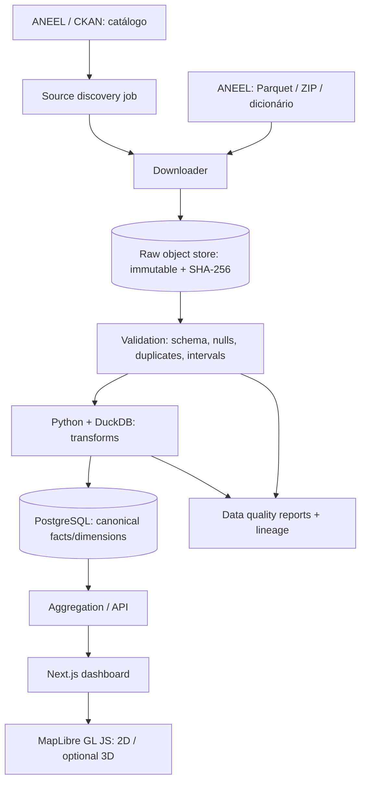

# Arquitetura do Illuminate

## Princípios

- **Correctness first**: transformar apenas dados cuja semântica e relação geográfica foram verificadas.
- **Rastreabilidade**: a mesma análise deve apontar para fonte, versão, data de coleta, transformação e SQL/método.
- **2D antes de 3D**: geometrias visuais são uma camada de apresentação, não precisão inventada.
- **Sem live tracking**: dados são publicados periodicamente e podem ser corrigidos retroativamente.
- **MVP enxuto**: evitar Kafka, Spark, microserviços e ML antes de existir carga que os justifique.

## Diagrama lógico



## Monorepo alvo (proposta; arquivos ainda não implementados)

```text
apps/
  web/                  # Next.js (interface e API BFF)
packages/
  contracts/            # contratos públicos entre ETL e API
pipelines/
  aneel/                # descobridor de recurso, download, validação, carga
  tests/                # fixtures sintéticas e testes da metodologia
infra/
  docker-compose.yml
docs/
  data-sources.md
  architecture.md
  data-model.md
  visualization.md
  methodology.md
  roadmap.md
```

## Estratégia de ingestão

- Descobrir recursos no CKAN e armazenar manifesto (`resource_id`, URL, período, tamanho, ETag, checksum se disponível).
- Download via HTTP com tentativas limitadas e recomeço seguro; nunca tratar resposta parcial como dataset completo.
- Armazenar blobs imutáveis com `sha256` e timestamp.
- DuckDB/Polars para introspecção e agregação offline de Parquet; processamento por ano/lote.
- Construir tabelas canônicas usando ID estável do conjunto e período de validade.
- Registrar resultados de qualidade e rejeitar alterações incompatíveis de schema até revisão.
- Materializar agregados por conjunto/ano/mês. Atualizações retroativas devem recalcular as partições envolvidas, não duplicá-las.
- Manter as fontes históricas e permitir refazer uma publicação a partir do manifesto.

## API proposta (ainda não implementada)

- `GET /api/v1/metadata`: versões, atualizações, metodologias e cobertura.
- `GET /api/v1/distributors`: filtros de agentes.
- `GET /api/v1/sets?state=RJ`: conjuntos disponíveis, com escopo geográfico validado.
- `GET /api/v1/continuity?set_id=...&from=2020&to=2025&metric=DEC`: séries temporais.
- `GET /api/v1/regions?metric=DEC&year=2025`: regiões **somente** quando for possível definir agregações sem dupla contagem e geometria válida.
- `GET /api/v1/analysis/{id}`: consulta compartilhável, filtros, proveniência e método.

Toda resposta de métrica deve carregar `source_version`, `retrieved_at`, `reference_period`, `methodology_version`, `geographic_level`, `coverage_notes` e unidade.

## Requisitos não funcionais

- Testes automáticos de schema, comparabilidade temporal, cardinalidade e ausência de dupla contagem.
- Logs estruturados de pipeline, execução idempotente e indicadores de data freshness.
- Performance: gerar agregados offline; não varrer Parquet bruto a cada clique.
- Segurança: não aceitar SQL arbitrário público; limites, cache, rate limiting.
- Acessibilidade: mapa acompanhado de tabela e gráficos em 2D; navegação por teclado.
- Licença: código MIT; metadados e conteúdo ANEEL com atribuição e licença própria.
